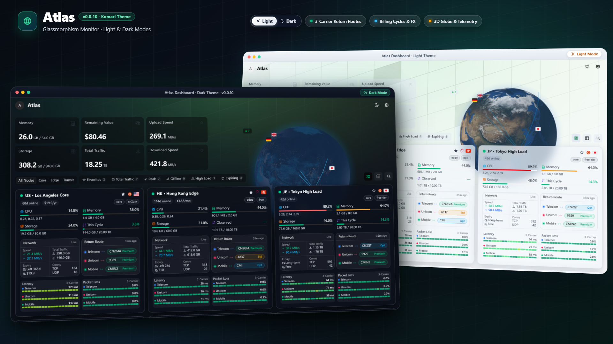

# Atlas

Atlas 是面向 Komari 的监控主题，由 MagnetOscar 基于 [Glassmorphism Enhanced v1.2.1](https://github.com/casiuna/Glassmorphism-Enhanced) 维护。保留原有毛玻璃布局、地图及地球；来源、原作者及第三方许可证见 [FORK.md](FORK.md)、[LICENSE](LICENSE) 和 [THIRD_PARTY.md](THIRD_PARTY.md)。

## Atlas v0.0.5 · 卡片与地球展示

合入 Antigravity PR #20 的响应式卡片、单行标签、网络／回程双栏与国旗避让，保留金额、重置时间和采集逻辑。主题管理仅上传原生主题 ZIP；独立插件和 TQ 继续使用 0.0.4 安装材料。详见 [0.0.5 版本说明](docs/release-notes-atlas-0.0.5.md)。

## Atlas v0.0.4 · Komari TcpQuality 附件

三网回程采用参考图的三行玻璃面板：运营商、线路徽标、等级／混合状态和更新时间。展开保留 IPv4、IPv6、UDP 两地址族及 IPv4 大包的省份分组，各分项不互相覆盖；缺失、混合、过期如实显示。三网顺序、独立重置、节点本币／单币种汇总、TCP/UDP、地球和地图保留。

TcpQuality 固定版本作为 Komari 附件，纳入现有服务代码／数据目录，不新增常驻服务或端口。节点本机采集，通过原生节点身份上报 CA 的 Komari 插件。既有 cron 只做到期检查，原生租约控制实际每小时一次；本轮仅 DMIT，IPv6 无连接时标为不可用。关闭测速、排名、报告上传及国际／教育网测试。上游 GPL 源码与许可保存在独立附件中，MIT 主题不复制其分类函数。

安装与边界见[附件说明](companion/tcpquality/README.md)、[与旧方法的差异](docs/tcpquality-0.0.4.md)及[版本说明](docs/release-notes-atlas-0.0.4.md)。主题 ZIP、原生插件 ZIP、Komari 附件 tar.gz 和安装适配文档独立提供，不能混装。精确发布状态、源码与校验以 [Releases](https://github.com/MagnetOscar/Atlas/releases) 为准。

## Atlas v0.0.3（历史版本）

首页原三块指标下新增 TCP／UDP 块，右侧两格为三网回程；按已保存运营商顺序显示，点击展开时间、目标与 ASN 观测。主题只读取结果，采集由独立插件与节点本地 Helper 完成。原始逐跳证据仅管理员可见，公开 ASN 摘要须显式启用。

「Atlas 管理 → 线路与延迟」开启回程显示、首页双格回程块及自动结果／伴生插件消费；旧配置默认保留原位置。插件和 Helper 使用各自的 ZIP，不能上传到主题管理中。安装方法、版本和下载状态以 [Atlas v0.0.3 Release](https://github.com/MagnetOscar/Atlas/releases/tag/atlas-v0.0.3) 为准；[桌面／手机预览](docs/previews/0.0.3) 为合成数据。

仅完成一个生产节点的一轮验证，未启动周期采集或推广到所有节点。部分目标未回应、协议路径不同，页面保留不确定状态，不把 ASN 观测当作商业线路认证。独立重置、节点本币／单币种汇总、三网排序、地图／地球及未知配置字段保留。见 [验证记录](docs/verification/production-trial-0.0.3.json)。升级前保留 0.0.2 ZIP 并备份设置，回滚时重新上传旧 ZIP；采集端独立停用，不删除节点或历史。

## Atlas v0.0.2（历史版本）

- 修复费用弹窗的边框、留白、按钮居中和三个原图标。
- 三网拖动排序并保存，支持触屏上移／下移及键盘操作。
- 延迟／丢包方块与波浪线切换；TCP、UDP 连接数分别显隐。
- 保留节点本币、单一币种汇总与独立重置时间；地图、地球及采集逻辑不变。

新选项在「Atlas 管理 → 线路与延迟」保存后全站生效；未设置时保持原显示。见 [正式 Release](https://github.com/MagnetOscar/Atlas/releases/tag/atlas-v0.0.2)、[桌面／手机预览（测试数据）](docs/previews/0.0.2) 和 [正式 ZIP 验证记录](docs/verification/atlas-release-0.0.2.json)。正式包通过 426 项单元／组件检查、237 项浏览器检查，实际下载附件再次通过 9 项原生安装、配置、升级与回滚检查。

## Atlas v0.0.1（历史版本）

- 工程流程：受保护 PR、质量与浏览器检查、原生安装 ZIP、源码及 SHA256 记录。
- 独立重置时间：逐节点时区、每月日期、小时和分钟，支持夏令时、月底及旧配置迁移。
- 金额与汇率：每台节点金额保持输入币种；首页顶栏使用已有 API 将金额统一换算为所选单一币种。

本次只将项目名称统一为 **Atlas**：页面、管理入口、页脚 `Theme by Atlas`、包元数据与构建产物同步使用新名字。三网排序、显示开关和回程采集扩展不在本次范围。

## 安装与升级

从 [Atlas Releases](https://github.com/MagnetOscar/Atlas/releases) 下载 `komari-theme-Atlas-build-<sha>.zip`，核对同版 SHA256，在 Komari 后台主题管理上传并启用。不要使用 Source code ZIP。实际验证目标为官方 Komari Server 1.6.1。

上传前保留现有主题 ZIP、主题配置及数据备份。新主题标识为 `short: Atlas`。首次启用后保持管理员登录；Atlas 通过官方受管理员保护的数据库接口，将旧 Enhanced 配置复制到尚未配置的 Atlas 身份。已有 Atlas 设置不会被覆盖，旧 Enhanced 配置也不删除。迁移核对包含节点独立重置时间、币种设置和未知配置字段。现有 Plugin/Helper 的接口标识也不改名、不自动安装或启用。

Release 标题统一为 **Atlas v版本号**；`atlas-v0.0.1` 绑定品牌统一后的准确源码。改名前的重复 Release 已从发行列表删除，原 `personal-v0.0.1` Git 标签及源码历史仍保留供追溯；正式 Atlas 版本的标签与安装包不变。

## 验证和边界

验收记录位于 [docs/verification](docs/verification)。安装包需通过真实隔离 Komari 的上传、配置保存、升级和回滚测试；合成历史／价格与生产验收明确区分。流量周期要求服务端有足够历史；汇率是参考报价。

本项目保留 MIT 与上游版权。上游历史说明见 [原 README 归档](docs/upstream-readme-v1.2.1.md)。开发和发布规则见 [AGENTS.md](AGENTS.md)、[docs/releasing.md](docs/releasing.md)。
