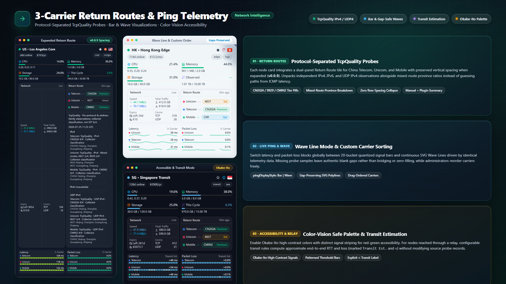
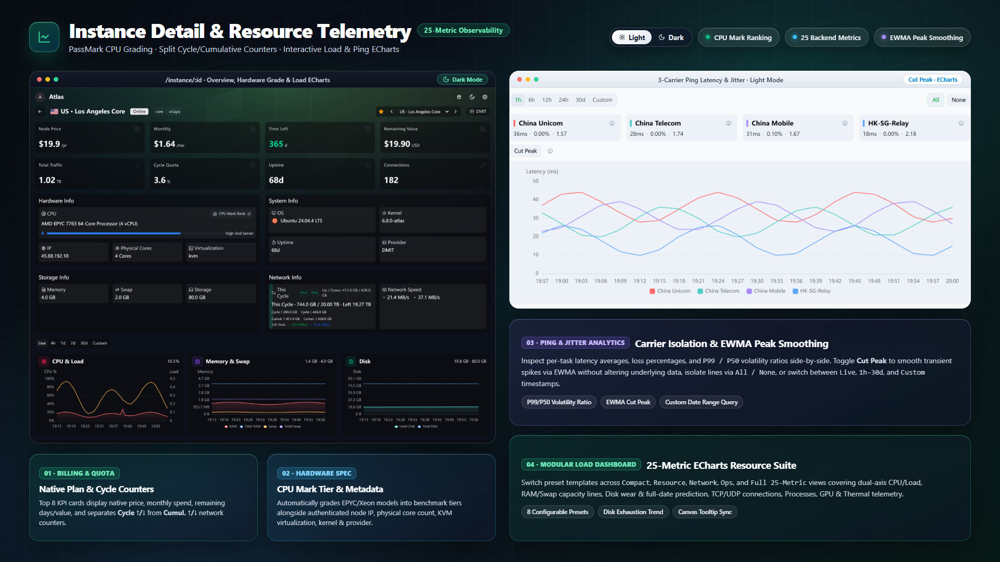
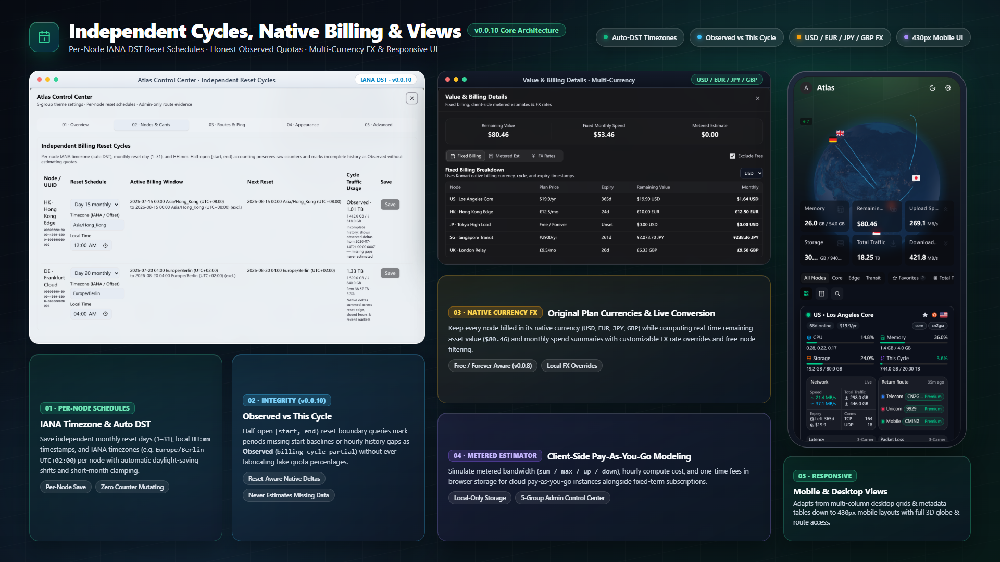

# Atlas

**让多台服务器的状态、流量和费用，一眼看清。**

Atlas 是基于 Komari 的毛玻璃监控主题，在原有节点监控、三网延迟和地球可视化之上，完善多币种费用、独立流量周期与回程线路展示。

[下载主题](https://github.com/MagnetOscar/Atlas/releases/latest) · [使用文档](docs/README.md) · [更新记录](CHANGELOG.md) · [可选回程组件](docs/components.md)

## 与上游有什么不同

| 需求                 | Atlas 的改进                                                                                   |
| -------------------- | ---------------------------------------------------------------------------------------------- |
| 多币种账单           | 节点金额保持输入币种；顶栏统一换算为选定币种，支持在线汇率、缓存和备用来源。                   |
| 不同供应商的流量周期 | 在上游独立重置日基础上，逐节点设置时区、每月日期和时分，处理夏令时与短月份。                   |
| 三网展示偏好         | 拖动保存运营商顺序；延迟／丢包可选方块或波浪线，TCP／UDP 数量可独立显示。                      |
| 回程线路信息         | 可选接入 TcpQuality，分别展示 IPv4、IPv6、UDP 和 IPv4 大包结果，明确标记未测、混合与过期状态。 |
| 首页信息密度         | 响应式卡片整合网络概览、连接数和三网回程，保留毛玻璃、地球及地图展示。                         |

以上优先列出 Atlas 在多币种账单、独立流量周期、三网显示选项和回程集成方面的改进。下方展示同时包含继承的资源监控、CPU 型号分级、历史图表、毛玻璃及地球等基础能力，不将其列为 Atlas 原创功能。主题只展示数据，自动回程采集需要另装可选组件。

## 界面与功能展示

> 以下展示图均为统一演示数据渲染，用于呈现 Atlas v0.0.10 的多模式布局与功能细节；其中 [主题头图](docs/preview.png) 用于 README 与主题市场展示，已发布的 0.0.10 ZIP 内置封面保持原样。

### 1. 三网回程、延迟与丢包可视化

- **分协议回程观测**：首页双栏回程块与展开面板支持分别展示电信 / 联通 / 移动的 IPv4、IPv6 与 UDP IPv4 结果及混合省份占比；展开详情时保持摘要行间距不被挤压，不以 ICMP 延迟冒充线路认证。
- **方块 / 波浪线与自定义排序**：三网延迟与丢包支持 20 格信号方块和缺样断口保留型 SVG 波浪线切换（缺失采样不会跨断点连线或补零），并可按偏好调整电信 / 联通 / 移动排序。
- **色觉友好与中转估算**：支持 Okabe-Ito 高对比度纹理配色方案；配置中转规则的节点会显式标记 `Transit Est.` / `≈` 估算值，不改动源站探测记录。

### 2. 实例详情、硬件跑分与交互式图表

- **概览指标与硬件分级**：详情页汇总价格、月均摊、剩余天数、剩余价值、周期配额与连接数；内置 CPU 型号天梯近似分级参考、物理核心与虚拟化信息，并在登录后展示真实节点 IP。
- **周期流量与累计计数拆分**：清晰区分当前计费周期上行/下行（`Cycle ↑/↓`）、累计流量计数（`Cumul. ↑/↓`）与近 24 小时网络速率峰值。
- **ECharts 多维度历史分析**：支持切换多套负载仪表板模板（CPU/负载、内存/Swap 总量、磁盘及预测、速率等），三网延迟图提供均值、丢包、`P99/P50` 波动率、自定义时间范围以及 EWMA 平滑峰值（Cut Peak）。

### 3. 独立时区流量周期、多币种账单与多端视图

- **每节点 IANA 时区重置周期**：在 **Atlas 集中管理 → 02 · 节点与卡片** 中可为每台机器单独配置每月重置日（1–31 日）、当地时分以及 IANA 时区（支持夏令时自动顺延及短月末对齐），不篡改累计计数器。
- **诚实的观测完整度状态**：严格按左闭右开 `[start, end)` 重置边界查询原生流量增量；当周期起点或中间小时历史存在缺口时显式标注为 **Observed**（已记录但不完整），绝不估算或伪造使用率百分比。
- **原生币种账单与多端适配**：保留节点原有 USD / EUR / JPY / GBP 等计费币种与免单/长期（`Free / Forever`）状态，配合实时汇率换算及前端按量估算模型；页面响应适配桌面宽屏与 `430px` 移动端卡片视图。

## 三步开始

1. 从 [最新 Release](https://github.com/MagnetOscar/Atlas/releases/latest) 下载 **komari-theme-Atlas-build-\*.zip**。
2. 在 Komari 后台 → 主题管理上传 ZIP，启用 **Atlas**。
3. 刷新主页；管理员可在 **Atlas 管理**中设置流量周期、三网顺序和显示选项。

已验证兼容 **Komari Server 1.6.1**。普通主题安装无需 Bun、Node.js 或 Python；GitHub 自动生成的 Source code 不是主题安装包。各版 SHA256 见 Release 说明与[下载索引](docs/downloads.md)。

完整周期统计需在 Komari 后端保留至少 **36 天流量历史**；安装主题不会自动修改该设置。配置方法见[流量周期说明](docs/traffic-cycles.md)。

升级时保留原 ZIP 与主题配置。旧 Enhanced 配置仅在 Atlas 配置缺失／为空且管理员已登录时迁移；已有 Atlas 配置不会被覆盖。[流量周期](docs/traffic-cycles.md) · [费用与汇率](docs/finance.md)

## 可选回程采集

主题可以独立使用。自动回程需要 Komari 插件和节点本机附件；它们**不包含在主题 ZIP 中**，不能上传到主题管理。查看[组件下载与安装](docs/components.md)。

回程标签是工具的观测分类，不同协议和省份可能不同，不代表运营商认证。精确流量周期取决于服务端保留的历史数据。

## 开发与反馈

[开发指南](docs/development.md) · [发布约定](docs/releasing.md) · [问题与改进](https://github.com/MagnetOscar/Atlas/pulls)

## 来源与许可

Atlas 由 MagnetOscar 基于 casiuna 的 [Glassmorphism Enhanced v1.2.1](https://github.com/casiuna/Glassmorphism-Enhanced) 二次开发；该项目源自 sanrokamlan-prog 的 [komari-theme-Glassmorphism](https://github.com/sanrokamlan-prog/komari-theme-Glassmorphism)。保留上游版权、原作者与第三方署名。主题沿用 [MIT License](LICENSE)；可选 TcpQuality 上游源码为 GPL-3.0-only，第三方组件遵循各自许可证。详见[项目来源](FORK.md)和[第三方声明](THIRD_PARTY.md)。
